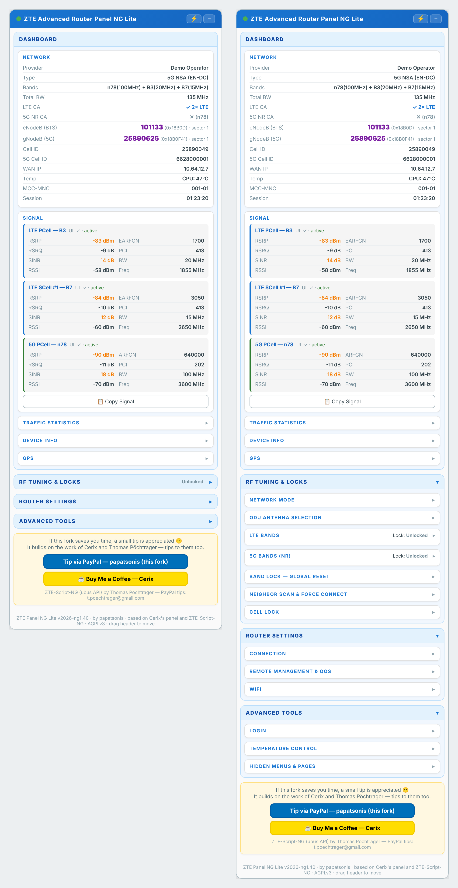
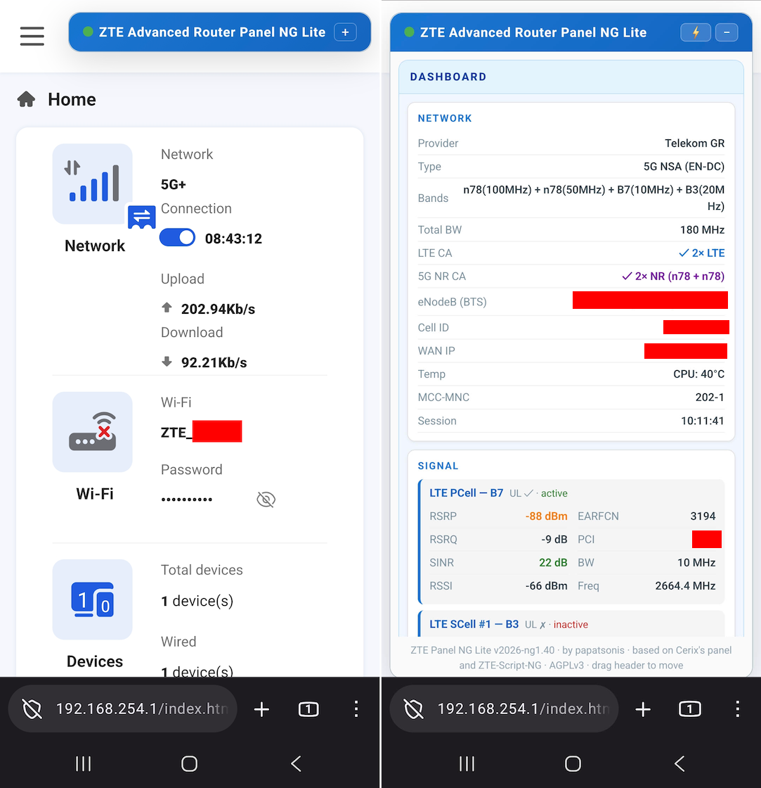

# ZTE Advanced Router Panel NG

A floating control panel for **ZTE 4G/5G routers**. It is a userscript: it runs inside the router's own web page and adds signal details, band and cell locking, network mode, a neighbor scan, bridge mode, ODU antenna selection, GPS, traffic statistics and more.

It works with both APIs that ZTE routers use behind their web page:

- **ubus** (JSON-RPC) — G5TC, MC7510, MC7530, MC8512, MC8532B and later;
- **goform** — MC801A, MC888, MC888A / Ultra, MC888B, MC889, MC889A / Pro.

What counts is the API, not how the router's web page looks: the MC888B and the MC889A Pro, for example, have the newer-looking web page but the goform API. The panel finds out by itself which API your router has. You install the same script either way and see the same panel; a control appears only if your router supports it.

This brings the [ZTE Advanced Router Panel](https://github.com/Cerix/zte-advanced-router-panel) design by **Cerix** to the ubus routers, built on the ubus foundation of [ZTE-Script-NG](https://github.com/tpoechtrager/ZTE-Web-Script) by **Thomas Pöchtrager**, and adds a large set of controls on top. Ported and extended by **[papatsonis](https://github.com/papatsonis)** — see [What this fork adds](#what-this-fork-adds) and [Credits](#credits).



*The Lite edition (1.40) with demo data: how it opens (left) and with the three groups unfolded (right).*



*On a phone: the panel folded over the router's page (left) and unfolded (right). Photo from version 1.37 on a real router; private values blacked out. The session line no longer shows the IP-renewal countdown ("IP ↻") since 1.40.*

## Upgrading from 1.39 or earlier: install again

> **Version 1.40 has a new name.** Up to 1.39 the script was called **"ZTE Advanced Router Panel NG (ubus)"** (Lite: **"… NG Lite (ubus)"**). It now serves the goform routers too, so the "(ubus)" is gone: **"ZTE Advanced Router Panel NG"** and **"ZTE Advanced Router Panel NG Lite"**.
>
> Userscript managers know a script by its name, so **the old installation does not update itself to 1.40**. To upgrade:
>
> 1. Install 1.40 with one of the links in [Two editions](#two-editions).
> 2. Delete (or disable) the old "… (ubus)" script in Tampermonkey / Violentmonkey.
>
> Do not keep both enabled: 1.40 notices an older copy that started first and stays off (*"Another ZTE panel script is already running on this page"*), but an old copy that starts second does not check. Your settings (auto-login password, folded sections) are kept in the browser for the router's address, so the new installation finds them as they were.

## Two editions

| Edition | For | Install |
|---|---|---|
| **Lite** | Everyday use. All the controls, none of the developer tools. | [zte-advanced-panel-ng-lite.user.js](https://raw.githubusercontent.com/papatsonis/zte-advanced-router-panel-ng/main/zte-advanced-panel-ng-lite.user.js) |
| **Full** | Everything in Lite, plus tools for exploring the router's API. | [zte-advanced-panel-ng.user.js](https://raw.githubusercontent.com/papatsonis/zte-advanced-router-panel-ng/main/zte-advanced-panel-ng.user.js) |

Install one of them. If you install both, keep only one enabled at a time.

## Install

1. Install a userscript manager in your browser: [Tampermonkey](https://www.tampermonkey.net/) or [Violentmonkey](https://violentmonkey.github.io/).
2. Click one of the install links in the table above and confirm the installation.
3. Open your router's web page and log in. The panel appears in the top-left corner a moment after the page has loaded.

The script runs on `192.168.0.1`, `192.168.1.1`, `192.168.8.1` and `192.168.254.1`. If your router uses another address, add a matching `@match` line at the top of the script.

## Features

The panel has four groups: **Dashboard** (always open), **RF Tuning & Locks**, **Router Settings** and **Advanced Tools**. The last three fold away; the folded RF bar shows which band and cell locks are active.

| Section | What it does |
|---|---|
| **Network** | Provider, network type, active bands, total bandwidth, LTE and 5G carrier aggregation, eNodeB / gNodeB, cell IDs, WAN IP, temperature, connection time |
| **Signal** | One card per LTE and 5G carrier: RSRP, RSRQ, SINR, RSSI, (E)ARFCN, PCI, bandwidth, frequency; copy a signal report |
| **ODU antenna selection** | Outdoor units: automatic, directional or omnidirectional, with the names the router uses. On goform routers also an **Auto-test** that tries each setting and keeps the best one. Shown only on models that have this setting |
| **Neighbor scan & force connect** | The cells the router can see, and a lock to any of them |
| **Connection** | Reconnect mobile data, DNS, bridge mode on/off, ARP proxy on/off (ubus routers), reboot |
| **Network mode** | 5G SA, 5G NSA, 4G/5G auto, LTE only — asks before it changes anything |
| **LTE bands / 5G bands** | One-click band locks with live status. Each frame lists the bands your router supports (read from the router); a lock the panel set is marked 🔒. Every lock is read back from the router before it shows ✓ |
| **Cell lock** | Lock or unlock an LTE cell (PCI + EARFCN) or a 5G cell (PCI + ARFCN + band); reset all band and cell locks. What you type is checked before anything is sent, and the lock is read back. The panel says when a lock needs a network-mode switch or a restart to apply |
| **Traffic statistics** | Live speeds, session, monthly and all-time totals; reset the monthly counters |
| **Device info** | CPU temperature and load, memory, uptime, WAN details, SIM info, hardware/software versions, SMS storage, APN (view and switch profile on ubus routers) |
| **GPS** | The position with a map link, or the last known one while there is no fix. Shown only on routers with GPS. Newer goform firmware sends the position encrypted; the panel lets the router's own page decrypt it |
| **WiFi** | Radio info, transmit power, country. Hidden on routers without WiFi |
| **Remote management & QoS** | QoS global speed cap with the router's own priority profiles, and TR-069 (ACS): CWMP and Periodic Inform on/off on ubus routers, the TR-069 state (read only) on goform routers. ACS addresses, users and passwords are never shown |
| **Login** | Optional auto login, developer login, and the session timeout (where the router supports it) |
| **Temperature control** | The firmware's overheating protection, on or off. Shown only if the router supports it |
| **Hidden menus & pages** | Shows menu entries the router's web interface hides, and lists pages the firmware has but links no menu entry for (Developer options, TR-069, SMS pages, …) — which the panel can open |

**Full edition only:** API finder (searches the router's own web code for a keyword), call recorder (logs the calls the router's pages make), custom ubus call, raw netinfo dump, raw scan data, 5G NSA lock probe.

## Compatibility

**ubus routers:** tested on a **G5TC** (B07 firmware), an **MC7510** (G5F, ODU), an **MC7530**, an **MC8512** (G5 Ultra) and an **MC8532B** (G5 Pro). For 1.40 the band and cell locks, network mode, reconnect, bridge/router mode, QoS, TR-069, WiFi transmit power and GPS were run on these models (each where the model has the feature).

**goform routers:** tested on an **MC801A**, an **MC888**, an **MC888A** and **MC888A Ultra**, an **MC888B**, an **MC889**, an **MC889A** (generic and operator firmware, before and after an update) and an **MC889A Pro**: band and cell locks with unlock, Reset ALL with restart, network mode, reconnect, antenna selection and Auto-test, GPS, auto login and the developer login.

Firmware differs between models and operators, so another ZTE router may work fully or only partly. If something misbehaves, please [open an issue](https://github.com/papatsonis/zte-advanced-router-panel-ng/issues) with the router model, its firmware version (ℹ️ HW / SW Version in the panel) and what you did.

## Things to know before you click

- **Everything stays local.** The script only talks to your router. The only outside links are the ones you click yourself (the map link and the tip links).
- **You log in on the router's own page.** The panel starts once you are in and pauses whenever you are logged out.
- **Auto login is optional and off by default.** If you turn it on (🔑 Auto Login), a hash of the router password is kept in the browser's storage for the router's address. Anyone who can use that browser profile can then open the router page, and the hash itself is enough to log in — so do not turn it on on a shared computer. "Forget Password" removes it.
- **Some changes need more rights than the normal login.** On some goform firmware a band or cell lock is refused with the normal login. The panel then tries the developer login once with the saved auto-login password, without asking; if that does not work it opens a dialog for the developer password and, for cell locks on routers that have one (MC888), the super admin password. The password you type goes to the router's own login function for that session only — it is never stored or shown. The change is then sent once more.
- **Band and cell locks stay in place** until you remove them. "Remove band lock" works by locking to all bands of your router. The panel reads that list from the router; only if the router reports none does it use the lists in the `CFG` block.
- **Locking to a cell of another operator** leaves the router without service until you unlock it. On ubus routers an LTE cell lock is applied for you in steps (LTE only → lock → back to your mode); expect the connection to drop for 10–20 seconds. On goform routers a cell lock often applies only after a restart — the panel offers one, and you can say no and let it apply at the next restart.
- **One radio change at a time.** Network mode, band and cell locks, the scan, the reconnect and the guided lock refuse to start while another one is running and say what is still running. A change the router does not answer is read back, never sent twice.
- **MC7510 (G5F) and G51F.** The MC7510 re-attaches the modem for about 20 seconds after every radio change, and changes sent closer together than that can leave it without service until a power cycle. On these models the panel waits 25 seconds between two such changes, sends an LTE cell lock directly, removes a cell lock with the router's own reset (which also puts the band locks back to the router's defaults) and waits 20 seconds between data off and on. The G51F is expected to behave the same way but has not been tested.
- **MC7510, G51F and MC8512 (MediaTek): 5G NSA band lock.** Only one value of the router's band-lock type reaches the 5G NSA list on these models; the panel always uses that one there.
- **Bridge mode** turns the router's routing off: the device on the LAN port gets the mobile IP directly, and Wi-Fi clients may lose internet. Try it from a computer connected by cable. The router restarts to switch.
- **ARP proxy** (ubus routers) is a hidden setting of the firmware; the router accepts the switch only in a developer session. If nothing changes on your network after switching, reboot the router.
- **Hidden Menus** shows menu entries and page parts that the router's own web interface hides (marked with a dashed outline). **Hidden pages** lists pages the firmware has but links no menu entry for and can open them; the router draws them as it normally would. A page of a feature your model does not have may come up empty; the router's own access rules still decide what any control on it may change.
- **QoS** sets one global speed cap for the whole router (an upload and a download limit) using the firmware's own priority profiles. It is a router-mode feature, so the panel hides it in bridge mode.
- **TR-069 (ACS)** is how an operator manages the router remotely. On ubus routers the panel can turn CWMP and Periodic Inform on or off; the ACS password stays inside the router. On goform routers the state is shown read only.
- **Groups and sections fold away.** Click a group bar or a section title to collapse or expand it (▾ / ▸). The panel remembers your choice per router. Collapsing does not stop anything from updating.
- **The neighbor scan disconnects mobile data** on ubus routers while it runs (about 30 seconds). The panel turns it back on afterwards.
- **Reconnect** switches mobile data off and on again. On some firmware the router ends the web session when it does that. With a saved password the panel logs in again and makes sure mobile data is back on by itself — this can take one or two page reloads. Without a saved password, log in again and the panel finishes the reconnect (on goform routers it asks first when the login comes more than 10 minutes later).
- **DNS**: on ubus routers the panel sets manual IPv4 and, optionally, IPv6 DNS (in the IPv6 prompt, keep the values shown to keep them; leave it empty or type `-` for none; `-` in one place clears just that one). On goform routers it opens the router's own page where DNS is set.
- **Router restarts** — if the router started within the last 10 minutes (a power cut, a reboot you did not start from the panel), the panel says so once. A restart the panel asked for is expected and logged in again by itself.
- **ODU antenna selection** is meant for debugging, according to ZTE: keep *Automatic* in normal use.
- **Temperature control** is the firmware's protection against overheating; keep it on.
- **Session timeout** accepts 60–86400 seconds. The router's own web interface does not offer it; the panel uses the firmware's own call.

This project is not affiliated with ZTE. Use it at your own risk.

## Auto login

With a saved password, the panel logs in for you when you open the router page and nobody is logged in. It logs in once and then reloads the page once, so that the router's own page starts up already logged in — you see a short flash of the login form first.

- It is skipped for about a minute after you press **Logout**, so logging out works. Reload the page later to log in again.
- If the router itself ends the session while the page is open — a timeout, a restart, or a change that resets it — the panel logs in again. A reconnect or guided cell lock that was cut off by this is finished afterwards.
- Without a saved password the panel never logs in: it pauses and waits for you.
- If the router rejects the saved password, the panel removes it and tells you.

## Configuration

A small `CFG` block at the top of the script holds the settings most people might change:

```js
var CFG = {
  bmac: true,              // false hides the tip box
  pollInterval: 1000,      // ms between signal refreshes
  lte_all_bands: [...],    // used only if the router does not report its own LTE bands
  nr_all_bands: [...],     // used only if the router does not report its own 5G bands
};
```

Five quick clicks on the panel's footer switch on verbose logging in the browser console (and off again); the setting is remembered in the browser.

## Development

The Lite edition is generated from the Full one. Edit only `zte-advanced-panel-ng.user.js`, then run:

```sh
python3 tools/build_lite.py
```

It needs Python 3 and Node.js (the result is checked with `node --check`). The build stops with an error if the Full script has changed in a way it does not expect, rather than producing a broken Lite edition. The published scripts carry no code comments (they are about a quarter smaller this way).

## What this fork adds

This fork brings together **Cerix's panel** (designed for ZTE's goform routers) and the **ubus foundation of ZTE-Script-NG** (for the G5TC-and-later models), extends it with a large set of **control** features, and since 1.40 serves the goform routers too, with the same panel.

From ZTE-Script-NG it inherits the ubus groundwork: signal monitoring, band and cell locking, network-mode switching, traffic statistics, device info, WiFi and login handling.

On top of that, this fork adds the following — all capability-gated, so a control appears only if the router answers for it:

- **Both APIs** — ubus and goform, detected by itself, with one panel. On goform routers the panel works through the router page's own functions.
- **Connection controls** — reconnect mobile data, DNS settings (IPv4 and IPv6), bridge mode on/off, reboot.
- **ARP proxy** on/off.
- **Neighbor scan & force connect** — see the cells the router can see and lock to any of them.
- **APN** — view and switch profile.
- **ODU antenna selection** — option names read from the router; Auto-test on goform routers.
- **GPS / GNSS** — including models that lack the `zwrt_gnss` service, and encrypted positions on newer goform firmware.
- **Session timeout** and **temperature control**.
- **Band lists read from the router**, so only bands your model supports are offered, and every lock read back.
- **Developer and super admin login** when a change needs it — tried once with the saved password, otherwise asked in a dialog, never stored.
- **QoS** — a global speed cap with the router's own priority profiles, read live.
- **TR-069 (ACS)** — CWMP and Periodic Inform toggles, without the panel ever handling the ACS password.
- **Hidden menus & pages** — reveals, and can open, pages the firmware hides (TR-069 config, Developer options, SMS pages).
- **Four groups with collapsible sections**, remembered per router, and a lock summary on the folded RF bar.
- **Guided LTE cell lock** — LTE only, lock, back to your mode, so the lock takes without stalling 5G NSA.
- **Recovery from a lost session** — with a saved password the panel logs in again when the router ends the session, and finishes a reconnect or cell lock that was cut off.
- **Two editions** — Lite (everyday) and Full (adds API-exploration tools), with Lite generated from Full by a build script.

### Version history

- **1.40** — **routers with the goform API are supported** (MC801A, MC888, MC888A / Ultra, MC888B, MC889, MC889A / Pro) by the same panel: signal, band and cell locks, network mode, reconnect, reboot, bridge mode, ODU antenna with Auto-test, GPS (also encrypted), neighbor cells, device info, hidden pages, auto login and a developer / super admin login when a change needs it. The name loses "(ubus)" — see [Upgrading](#upgrading-from-139-or-earlier-install-again). On ubus routers: every change read back before ✓ and an unanswered one checked, never sent twice; network-mode changes ask first; cell IDs shown in decimal, "no cell" IDs hidden; a calm note for a restart the panel asked for; the GPS section only where there is GPS; the IP-renewal countdown removed. Secrets are never shown or copied; the published scripts carry no comments.
- **1.39** — a sturdier reconnect and neighbor scan; one radio change at a time; network-mode and band-lock results read back before ✓; MC7510 (G5F) / G51F handling (25 s between radio changes, direct LTE cell lock, unlock by the router's reset, LTE bands above B64); the MediaTek 5G NSA band-lock value on the MC7510, G51F and MC8512; QoS limits above 127 Mb/s stored correctly; secrets hidden in copied reports; less flicker.
- **1.38.1** — code cleanup only; no change in what the panel does.
- **1.38** — IPv6 manual DNS; cell-lock entries checked before sending and read back; the guided LTE cell lock restores your mode when it cannot switch; an interrupted reconnect is finished in the page; restart notice; lighter polling; auto-login SHA-256 fix; Esc closes dialogs; verbose logging by five clicks on the footer.
- **1.37** — a reconnect cut off by a session end (MC7530) is finished after the next login instead of leaving data off; calmer messages; the panel fits a phone screen.
- **1.36** — four groups (Dashboard, RF Tuning & Locks, Router Settings, Advanced Tools) with the active locks on the folded RF bar; guided LTE cell lock; automatic re-login that finishes an interrupted reconnect or cell lock; Logout recognised.
- **1.35** — credits and authorship (this section, header and footer).
- **1.34** — removed a redundant 5G carrier badge; ARP proxy shows its default.
- **1.33** — collapsible sections, remembered per router.
- **1.32** — QoS speed cap, TR-069 (CWMP + Periodic Inform) toggles, opening firmware-hidden pages.
- **1.31** — band buttons driven by the router's supported-band list, with a "Supported bands" line.
- **1.30** — GPS on models without `zwrt_gnss` (e.g. G5TC); band lists read from the router.
- **1.29** — reliable detection of a lost session on firmware that answers some calls without login.
- **1.28** — ODU antenna selection; GPS presence; session timeout; temperature control.
- **1.27** — ARP proxy on/off; hidden menus and hidden pages.
- **1.25** — fixed the logout right after login; safer auto-login.
- **1.21** — first public release on GitHub. Development began earlier at 1.0; pre-1.21 builds were private. At 1.21 the fork already had signal, band/cell lock, network mode, neighbor scan, bridge mode, DNS, APN, traffic stats, GPS, WiFi, auto-login, and the developer tools.

## Credits

This panel exists because of other people's work:

- **[papatsonis](https://github.com/papatsonis)** — this fork: the port to the ubus JSON-RPC API, the goform backend and the features in [What this fork adds](#what-this-fork-adds). Built on the work below; not maintained or endorsed by those authors. Tips: [paypal.me/skaranik](https://paypal.me/skaranik)
- **[Cerix](https://github.com/Cerix/zte-advanced-router-panel)** — *ZTE Advanced Router Panel* (MIT). The panel's design, layout and feature set come from it. Tips: [buymeacoffee.com/cerix](https://buymeacoffee.com/cerix)
- **[Thomas Pöchtrager](https://github.com/tpoechtrager/ZTE-Web-Script)** — *ZTE-Script-NG* (AGPLv3+). The ubus calls, login flow, signal parsing and frequency tables come from it. Tips: PayPal `t.poechtrager@gmail.com`
- **[open-u60-pro](https://github.com/jesther-ai/open-u60-pro)** by Jesther Silvestre and **[zte-u60-pro-mu5250-manager](https://github.com/faying/zte-u60-pro-mu5250-manager)** by faying (both MIT) — their research on the ZTE U60 Pro showed which ubus calls exist for the neighbor scan, mobile data on/off, DNS, APN, ARP proxy and resetting locks. Only the call and parameter names were used; no code from them is included.

This version is a separate, modified work. It is not maintained or endorsed by the original authors, so please report problems [here](https://github.com/papatsonis/zte-advanced-router-panel-ng/issues) and not to them.

## License

[GNU Affero General Public License v3.0 or later](LICENSE). Notices for the works this one is based on are in [THIRD-PARTY-NOTICES.md](THIRD-PARTY-NOTICES.md).
